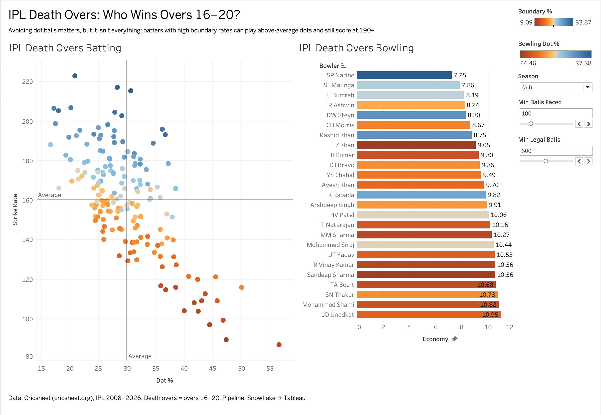

# IPL Death Overs Analytics Pipeline

An end-to-end analytics project on every IPL match from 2008 to 2026: ball-by-ball JSON from Cricsheet is loaded into Snowflake, modeled through raw, staging, and mart layers in SQL, and visualized in an interactive Tableau dashboard about who wins the death overs (overs 16 to 20).

**Live dashboard:** [Tableau Public link](https://public.tableau.com/views/IplDeathOversDashboard/IPLDeathOversDashboard?:language=en-US&:sid=&:redirect=auth&publish=yes&showOnboarding=true&:display_count=n&:origin=viz_share_link)



## Architecture

```
Cricsheet JSON (1,243 matches)
        │  scripts/build_ndjson.py
        ▼
Snowflake internal stage
        │  COPY INTO
        ▼
RAW.MATCHES          one VARIANT row per match
        │  LATERAL FLATTEN (innings → overs → deliveries)
        ▼
STAGING.DELIVERIES   one row per ball (295,557 rows)
        │  aggregation + window functions
        ▼
MARTS                batter_phase_stats, bowler_phase_stats, batter_form
        │  CSV export
        ▼
Tableau dashboard
```

## Repository layout

| Path | Contents |
|---|---|
| `sql/01_setup.sql` | Warehouse, database, schema layers, file format, stage |
| `sql/02_load_raw.sql` | Loads the combined JSON into a `VARIANT` column |
| `sql/03_staging_deliveries.sql` | Flattens nested match JSON into one row per delivery |
| `sql/04_marts.sql` | Phase-level batting and bowling stats, rolling batter form |
| `scripts/build_ndjson.py` | Combines Cricsheet's per-match files into one upload file |
| `data/marts/` | Exported mart tables used by the dashboard |
| `tableau/` | Packaged Tableau workbook (`.twbx`) |

## Modeling decisions

- **Semi-structured data stays semi-structured until staging.** Each match lands as a single `VARIANT` value, and the nesting is unpacked with three chained `LATERAL FLATTEN` calls, so the raw layer is an exact copy of the source.
- **Super overs are excluded.** They're tiebreakers rather than normal match play, and including them would distort death-over numbers.
- **Seasons come from the match date.** Cricsheet labels some seasons as ranges such as "2020/21", so the year of the first match date is used instead.
- **Balls faced exclude wides but include no-balls**, since a batter can score off a no-ball but not a wide.
- **Bowler runs conceded exclude byes and leg byes**, and run outs and retirements aren't counted as bowler wickets, following standard cricket scoring.
- **Marts store raw counts, not rates.** Strike rate, dot percentage, and economy are computed in Tableau as ratios of sums, so a short innings never carries the same weight as a full season.
- **Rolling form sums runs and balls over a batter's last five innings** rather than averaging five strike rates, for the same reason.

## Validation

The staging table was checked against official records before any analysis. Virat Kohli's season totals match the official figure in all 17 seasons from 2008 through 2024 (165, 246, 307, 557, 364, 634, 359, 505, 973, 308, 530, 464, 466, 405, 341, 639, 741), which confirms that flattening, extras handling, and the super-over filter are correct. Match counts per season also line up with known league formats, including the expanded 2011 to 2013 seasons and three matches in 2024 that were abandoned without a ball bowled. Seasons 2025 and 2026 are structurally consistent but haven't been checked player by player.

## Findings

- **Dot balls and strike rate are tightly linked at the death, but boundary hitting breaks the pattern.** AB de Villiers has the highest death-over strike rate in IPL history among batters with 400+ balls (222.9) while playing only 21% dot balls. Andre Russell reaches nearly the same level (195.9) despite playing 36% dot balls, because he hits enough boundaries to make up for them.
- **Sunil Narine has the lowest career death-over economy** among bowlers with 600+ legal balls (7.25), ahead of Lasith Malinga and Jasprit Bumrah.
- **Scoring rose sharply from 2023**, the season the Impact Player rule added an extra batter to every lineup, and has kept rising since.

## Limitations

- Cricsheet is compiled from scorecards rather than official league feeds, so isolated errors may exist, though they're too small to affect aggregates of 100+ balls.
- Dismissals are counted as `player_out = batter`, which misses a non-striker being run out and slightly undercounts dismissals.
- Death overs are defined as overs 16 to 20 for every match, including shortened ones.

## Reproducing

1. Download `ipl_json.zip` from cricsheet.org and unzip it into `data/ipl_json/`.
2. Run `python scripts/build_ndjson.py`.
3. Run `sql/01_setup.sql` in Snowflake, upload `data/ipl_matches.ndjson` to `@ipl.raw.cricsheet_stage`, then run the remaining SQL files in order.

## Data and license

Ball-by-ball data from [Cricsheet](https://cricsheet.org), used under its attribution license.

**Tools:** Snowflake (SQL, VARIANT, LATERAL FLATTEN, window functions), Python, Tableau
